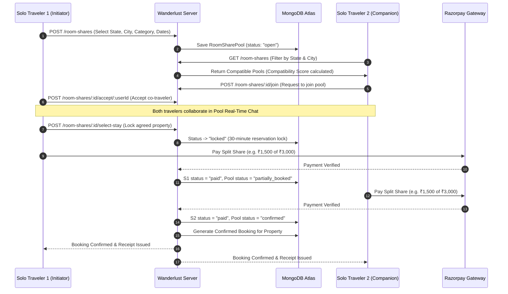
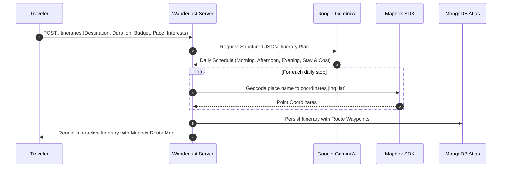

<div align="center">

# 🏡 Wanderlust

### Discover a stay. Match with travel companions. Plan with AI. Travel with confidence.

A production-grade, full-stack vacation rental & solo travel companion matching platform — built end-to-end with Node.js, Express, MongoDB Atlas, EJS Mate, Google Gemini AI, Mapbox GL geocoding, Cloudinary image storage, multi-account Razorpay split payments, and a 41-test Jest suite.

[](https://nodejs.org/)
[](https://expressjs.com/)
[](https://www.mongodb.com/)
[](https://ejs.co/)
[](https://www.passportjs.org/)
[](https://razorpay.com/)
[](https://ai.google.dev/)
[](https://www.mapbox.com/)
[](https://jestjs.io/)
[](https://wanderlust.swarajvecha.in/)

[](https://github.com/Swarajbabu/Wanderlust-Travel-Stay-Booking-Application/stargazers)
[](https://github.com/Swarajbabu/Wanderlust-Travel-Stay-Booking-Application/commits/main)
[](https://github.com/Swarajbabu/Wanderlust-Travel-Stay-Booking-Application/issues)

[**🌐 Live Demo**](https://wanderlust.swarajvecha.in/) · [**Report Bug**](https://github.com/Swarajbabu/Wanderlust-Travel-Stay-Booking-Application/issues) · [**Request Feature**](https://github.com/Swarajbabu/Wanderlust-Travel-Stay-Booking-Application/issues)

</div>

---

## 📸 Project Preview

| Feature / Page | Description |
|---|---|
| **Homepage & Infinite Scroll** | Lazy loading with `IntersectionObserver`, dynamic GST tax calculator toggle, Mapbox cluster map view |
| **Solo Room Shares & Match** | State & City cascading stay discovery, compatibility scoring, live pool chat, multi-account split payments |
| **AI Travel Planner** | Personalized multi-day custom itineraries powered by Google Gemini AI with interactive Mapbox route maps |
| **AI Travel Chatbot** | 24/7 floating assistant with contextual recommendations and itinerary suggestions |
| **Listing Details & Reviews** | Real-time calendar availability, verified guest reviews gated by completed stays, host profile |
| **Booking & Split Checkout** | Individual Razorpay checkouts per co-traveler, partial booking reservation locks, automated cancellation refunds |
| **Wishlist & User Profile** | Instant AJAX save/heart stays, travel preferences (gender, sleep schedule, smoking rule) |
| **Host Dashboard** | Occupancy metrics, revenue analytics, listing lifecycle management, booking approvals |

---

## 📑 Table of Contents

- [About The Project](#-about-the-project)
- [Key Features](#-key-features)
  - [👥 Solo Room Sharing & Companion Matching](#-solo-room-sharing--companion-matching)
  - [🤖 AI Travel Planner & Chatbot](#-ai-travel-planner--chatbot)
  - [🏡 Property Listings & Infinite Scroll](#-property-listings--infinite-scroll)
  - [💳 Bookings, Multi-Account Split Payments & Refunds](#-bookings-multi-account-split-payments--refunds)
  - [⭐ Verified Reviews & Wishlist](#-verified-reviews--wishlist)
  - [🔐 Authentication & Authorization](#-authentication--authorization)
  - [📱 Fully Responsive Cross-Device UI](#-fully-responsive-cross-device-ui)
- [Tech Stack](#-tech-stack)
- [Architecture](#-architecture)
- [Application Flow & Sequence Diagrams](#-application-flow--sequence-diagrams)
- [Database Design](#-database-design)
- [API / Routes](#-api--routes)
- [Project Structure](#-project-structure)
- [Installation & Setup](#-installation--setup)
- [Environment Variables](#-environment-variables)
- [Running Locally](#-running-locally)
- [Testing](#-testing)
- [Security & Performance](#-security--performance)
- [Author & License](#-author--license)

---

## 🧭 About The Project

**Wanderlust** is a vacation rental and social travel platform that goes beyond standard booking portals. It solves real-world challenges faced by both property hosts and solo travelers:

1. **The Solo Travel Cost Barrier:** Solo travelers often pay the full price of a double room or hesitate to travel alone. Wanderlust introduces a dedicated **Solo Room Sharing & Companion Match** engine where travelers post stay requests, filter by **State → City → Stay**, match via an intelligent compatibility algorithm, collaborate in real-time pool chats, and split booking payments directly across their individual Razorpay accounts.
2. **Double-Booking & Split Payment Integrity:** Accommodations are reserved under a **Payment Lock** window (30-minute TTL). If Member A pays ₹1,500 and Member B hasn't paid yet, the pool remains in `partially_booked` status; only when all co-travelers complete their payment is the room confirmed. If a member becomes unresponsive, the initiator can cancel with automated refund tracking.
3. **AI-Powered Travel Discovery:** Integrated with **Google Gemini AI**, Wanderlust automatically generates tailored multi-day travel itineraries complete with morning/afternoon/evening stops, hotel stays, budgets, and Mapbox visual route maps.
4. **Smooth Performance & Lazy Loading:** The homepage replaces clunky pagination buttons with smooth infinite scroll lazy loading via `IntersectionObserver`, coupled with dynamic 18% GST tax toggle synchronization.

---

## ✨ Key Features

### 👥 Solo Room Sharing & Companion Matching
- **Interactive On/Off Toggle Mode:** Clean toggle button (`Post Solo Room Share` [ON / OFF]) that reveals or hides the submission drawer smoothly.
- **Cascading State & City Hierarchy:** Automatic geographic grouping (`1. State` → `2. City` → `3. Specific Stay`). Only states with valid properties are displayed, dynamically populating matching cities and share-enabled listings without clutter.
- **Flexible Request Creation:** Post stay requests either with a specific stay chosen upfront OR select State & City to decide the property collaboratively inside the pool chat.
- **Compatibility Scoring Engine (`services/companionMatcher.js`):** Matches travelers based on travel personality, companion gender preferences (`Open to Any Gender` / `Same Gender Only`), smoking preferences (`Non-Smoker Only` / `Smoker Friendly` / `No Preference`), sleep schedules (`Early Riser` / `Night Owl` / `Flexible`), and target budgets.
- **Real-Time Group Chat:** Built-in chat room for every pool where verified participants discuss travel dates, activities, and stay choices before committing funds.
- **Multi-Account Split Payments:** Seamless split payments where each traveler pays their proportional share (e.g. 50/50 split of ₹3,000 = ₹1,500 each) via their own Razorpay account.
- **Partial Booking & Reservation Lock (30-Min TTL):** Prevents date collision while awaiting companion payments. Confirmed only when all co-travelers pay.
- **Cancellation & Unresponsive Member Flow:** If a companion fails to complete payment or abandons the pool, the initiator can cancel the request with structured reasons and claim their refund.

### 🤖 AI Travel Planner & Chatbot
- **Gemini AI Multi-Day Itinerary Engine:** Generates comprehensive daily schedules (Day 1..Day 14) with activities, estimated costs, recommended homestays, and packing advice.
- **Interactive Route Map:** Plotted on Mapbox GL with connected coordinates showing exact sequence of daily stops.
- **24/7 Contextual Travel Chatbot:** Floating assistant on all pages (`/api/chat`) providing destination tips, weather guidance, and instant stay recommendations based on current location and preferences.

### 🏡 Property Listings & Infinite Scroll
- **Infinite Scroll Lazy Loading:** Responsive grid that asynchronously fetches the next batch of properties (`/listings?format=json&page=...`) using `IntersectionObserver`, with fallback "Load More Stays" button and spinner.
- **Dynamic 18% GST Tax Switch:** Real-time price display toggle displaying total cost including taxes across all dynamically loaded cards.
- **Dual View Modes:** Seamlessly switch between the responsive Card Grid view and the interactive Mapbox Cluster Map view.
- **17 Curated Categories:** Instant filtering across Iconic Cities, Mountains, Castles, Amazing Pools, Camping, Farms, Arctic, Beach, and more.
- **Cloudinary Image Management:** Optimized image uploads with automated format conversion and thumbnail generation.
- **Mapbox Forward Geocoding:** Auto-computes latitude and longitude coordinates from plain text addresses.

### 💳 Bookings, Multi-Account Split Payments & Refunds
- **Server-Side Price Calculation:** Server strictly computes nights × nightly rate + taxes — client price tampering is impossible.
- **Real-Time Calendar Availability:** Flatpickr calendar automatically disables already-booked dates to prevent collision.
- **Razorpay Payment Verification:** Payment signatures are verified server-side with HMAC-SHA256 before marking bookings as confirmed.
- **Automated Cancellation Refund Policy:** Graded refund tiers (100% refund > 48h before check-in, 50% within 24-48h, non-refundable < 24h).
- **Printable Invoices & Receipts:** Clean booking receipt views (`/bookings/:id/receipt`) with QR verification.

### ⭐ Verified Reviews & Wishlist
- **Gated Verified Stay Reviews:** Only travelers with a **confirmed** booking whose checkout date has passed can submit a review and 1-5 star rating.
- **Instant Wishlist (Save to Favorites):** One-click AJAX heart button on property cards, organized in a dedicated `/profile/wishlist` dashboard.

### 🔐 Authentication & Authorization
- **Multi-Strategy Passport Auth:** Local email/username + password, Google OAuth 2.0, and passwordless email OTP.
- **Strict Role-Based Middleware:** Ownership verification for editing/deleting listings, review author checks, and booking participant authorization.
- **Session Persistence with Shared Mongo Client:** Sessions stored via `connect-mongo` using a shared client promise with Mongoose to prevent duplicate connections and Windows DNS SRV lookup timeouts.

### 📱 Fully Responsive Cross-Device UI
- Optimized for **Mobile (< 576px)**, **Tablet (576px - 991px)**, **Laptop (992px - 1399px)**, and **Large Screens (1400px+)**.
- Mobile-friendly horizontal swipe tabs for itinerary days (Day 1..Day 14).
- Floating chatbot panel adapts intelligently to mobile viewport heights without overflowing.
- Mapbox maps stack neatly on mobile while staying sticky on desktop viewports.

---

## 🧰 Tech Stack

| Category | Technology | Purpose |
|---|---|---|
| **Runtime** | Node.js (v20+ / v25) | High-performance asynchronous JavaScript server runtime |
| **Web Framework** | Express.js | Robust HTTP routing, middleware pipeline, REST APIs |
| **Database & ODM** | MongoDB Atlas & Mongoose | Scalable document database with schema validation and population |
| **AI Integration** | Google Gemini AI (`@google/genai`) | Intelligent multi-day itinerary generation & travel chatbot |
| **Template Engine** | EJS + `ejs-mate` | Modular server-rendered views with layouts and partials |
| **Authentication** | Passport.js (`local`, `google-oauth20`) | Multi-strategy authentication and session serialization |
| **Session Management** | `express-session` + `connect-mongo` | Resilient, distributed session storage sharing Mongoose client |
| **Payment Gateway** | Razorpay Node SDK | Split payments, order creation, and HMAC-SHA256 signature verification |
| **Maps & Geocoding** | Mapbox GL JS & SDK | Interactive vector maps, cluster pins, and coordinate geocoding |
| **Image Storage** | Cloudinary & Multer | Cloud asset storage, image optimization, and CDN delivery |
| **Input Validation** | Joi | Strict schema validation for listings, reviews, bookings, and room shares |
| **Security & Headers** | Helmet, `csrf-csrf`, `express-rate-limit` | Content Security Policy, double-submit cookie CSRF, and rate throttling |
| **Testing** | Jest, Supertest, `mongodb-memory-server` | 41 unit & integration tests covering auth, bookings, room shares, AI, reviews |

---

## 🏗️ Architecture

```mermaid
flowchart TD
    Client["Client Devices (Mobile / Tablet / Desktop)"] -->|HTTPS Requests| ExpressApp["Express Application (app.js)"]
    
    subgraph SecurityPipeline ["Security & Session Pipeline"]
        Helmet["Helmet (CSP Headers)"]
        RateLimit["Rate Limiting"]
        CSRF["Double-Submit CSRF (csrf-csrf)"]
        Session["express-session + connect-mongo"]
    end
    ExpressApp --> SecurityPipeline
    
    subgraph RoutingLayer ["Express Routing Layer"]
        R_Listing["/listings (Listing CRUD, Search, Lazy Loading)"]
        R_RoomShare["/room-shares (Matching, Chat, Split Pay)"]
        R_Itinerary["/itineraries (AI Generator, Route Map)"]
        R_Chatbot["/api/chat (Gemini AI Assistant)"]
        R_Booking["/bookings (Checkout, Razorpay Verification)"]
        R_User["/user (Auth, OTP, Google OAuth, Wishlist)"]
    end
    SecurityPipeline --> RoutingLayer
    
    subgraph ServiceLayer ["Business Logic & Services"]
        Matcher["Companion Matcher (services/companionMatcher.js)"]
        LocTree["Location Hierarchy (utils/locationHierarchy.js)"]
        GeminiClient["Gemini AI Client (utility/geminiClient.js)"]
        BookingHelper["Pricing & Razorpay Helper (utility/bookingHelpers.js)"]
    end
    RoutingLayer --> ServiceLayer
    
    subgraph ExternalServices ["External Services & Storage"]
        MongoAtlas[("MongoDB Atlas")]
        Cloudinary["Cloudinary CDN"]
        Mapbox["Mapbox Geocoding & Tiles"]
        Razorpay["Razorpay Gateway"]
        GeminiAPI["Google Gemini AI"]
        Nodemailer["Nodemailer (SMTP / Log Stub)"]
    end
    ServiceLayer --> ExternalServices
```



---

## 🔄 Application Flow & Sequence Diagrams

### 1. Solo Room Sharing & Split Payment Lifecycle



### 2. AI Multi-Day Itinerary Generation Flow



---

## 🗄️ Database Design

Six Mongoose models form the application schema:

```
User
 ├── owns                  → Listing.owner
 ├── writes                → Review.author
 ├── books                 → Booking.guest
 ├── initiates/joins       → RoomSharePool.participants
 └── generates             → Itinerary.user

Listing
 ├── belongs to            → User (owner)
 ├── has many              → Review (embedded ref array)
 ├── has many              → Booking
 └── featured in           → RoomSharePool.listing

RoomSharePool
 ├── initiated by          → User (initiator)
 ├── references stay       → Listing
 ├── participants          → Array of { user, joinStatus, paymentStatus, amountDue }
 └── messages              → Array of { sender, message, sentAt }

Itinerary
 ├── generated by          → User
 └── contains              → Days array (stops, coordinates, estimatedCost)

Booking
 ├── references stay       → Listing
 ├── guest account         → User
 └── split pool reference  → RoomSharePool (optional for group bookings)

Review
 ├── written by            → User (author)
 └── reviewed stay         → Listing
```

---

## 🔌 API / Routes

### Listings (`/listings`)
| Method | Route | Description | Access Control |
|---|---|---|---|
| `GET` | `/listings` | List stays with search, category filters, and lazy load JSON pagination | Public |
| `POST` | `/listings` | Create a new property with Cloudinary image and Mapbox geocoding | `isLoggedIn`, `isEmailVerified` |
| `GET` | `/listings/new` | Form to create a property | `isLoggedIn`, `isEmailVerified` |
| `GET` | `/listings/:id` | View property details, availability calendar, and reviews | Public |
| `PUT` | `/listings/:id` | Update property details | `isLoggedIn`, `isOwner` |
| `DELETE` | `/listings/:id` | Delete listing and cascade delete its reviews | `isLoggedIn`, `isOwner` |
| `POST` | `/listings/:id/wishlist`| Toggle stay in user's saved wishlist | `isLoggedIn` |

### Solo Room Shares (`/room-shares`)
| Method | Route | Description | Access Control |
|---|---|---|---|
| `GET` | `/room-shares` | Explore room share requests with State & City filters and match scores | Public |
| `POST` | `/room-shares` | Post a solo room share request | `isLoggedIn` |
| `GET` | `/room-shares/:id` | View pool details, compatibility scorecard, and live chat | Public / Participant |
| `POST` | `/room-shares/:id/join` | Request to join an open pool | `isLoggedIn` |
| `POST` | `/room-shares/:id/chat` | Send a message in the pool live chat | Pool Participant |
| `POST` | `/room-shares/:id/select-stay` | Pick the agreed property for split booking | Pool Initiator |
| `GET` | `/room-shares/:id/checkout` | Render personal split payment Razorpay checkout | Accepted Pool Member |
| `POST` | `/room-shares/:id/verify-payment` | Verify Razorpay HMAC signature for member's split | Accepted Pool Member |
| `POST` | `/room-shares/:id/cancel` | Cancel pool request or refund partially paid shares | Pool Participant |

### AI Travel Planner & Chatbot (`/itineraries`, `/api/chat`)
| Method | Route | Description | Access Control |
|---|---|---|---|
| `GET` | `/itineraries` | View user's saved AI itineraries | `isLoggedIn` |
| `GET` | `/itineraries/new` | Interactive form to generate customized multi-day travel plans | `isLoggedIn` |
| `POST` | `/itineraries` | Trigger Google Gemini AI generation and Mapbox coordinate plotting | `isLoggedIn` |
| `GET` | `/itineraries/:id` | View day-by-day plan with interactive route map | `isLoggedIn` |
| `POST` | `/api/chat` | AI chatbot conversation endpoint for travel guidance | Public |
| `GET` | `/api/chat/suggestions` | Contextual prompt chips based on active location and stay | Public |

### Bookings & Checkout (`/bookings`)
| Method | Route | Description | Access Control |
|---|---|---|---|
| `POST` | `/listings/:id/bookings` | Create a booking reservation with date overlap validation | `isLoggedIn` |
| `GET` | `/listings/:id/bookings/booked-dates` | Return booked date ranges (JSON for calendar disabling) | Public |
| `GET` | `/bookings` | Guest dashboard for personal bookings | `isLoggedIn` |
| `GET` | `/bookings/:id/checkout` | Razorpay payment checkout page | `isLoggedIn`, `isBookingGuest` |
| `POST` | `/bookings/:id/verify-payment` | Verify Razorpay HMAC-SHA256 signature and confirm stay | `isLoggedIn`, `isBookingGuest` |
| `PATCH`| `/bookings/:id/cancel` | Cancel booking with automated tier-based refund calculation | `isLoggedIn`, `isBookingGuestOrOwner` |
| `GET` | `/bookings/:id/receipt` | View or print formal booking receipt / tax invoice | `isLoggedIn`, `isBookingGuestOrOwner` |

---

## 📁 Project Structure

```text
Major Project Using HCJNE Stacks/
├── config/
│   ├── csrf.js                 # Double-submit cookie CSRF configuration
│   ├── db.js                   # Mongoose connection with exponential backoff retry
│   ├── email.js                # Nodemailer transport (with development logger stub)
│   ├── logger.js               # Winston structured logging
│   ├── passport.js             # Local & Google OAuth 2.0 Passport strategies
│   ├── session.js              # express-session sharing Mongoose client with connect-mongo
│   └── validateEnv.js          # Startup environment variables validation
│
├── controllers/
│   ├── booking.js              # Reservation logic, Razorpay checkout & refund calculation
│   ├── chatbot.js              # Gemini AI chat endpoint and contextual suggestion chips
│   ├── host.js                 # Host dashboard analytics, earnings & occupancy metrics
│   ├── itinerary.js            # Gemini AI multi-day planner & Mapbox route generation
│   ├── listing.js              # Listing CRUD, text search, JSON API & infinite scroll
│   ├── review.js               # Review creation (verified stay check) & deletion
│   ├── roomShare.js            # Solo room sharing matching, pool chat & split payments
│   └── user.js                 # Local signup/login, Google OAuth, OTP verification & wishlist
│
├── modals/                     # Mongoose Schemas & Models
│   ├── booking.js
│   ├── itinerary.js
│   ├── listing.js
│   ├── review.js
│   ├── roomShare.js
│   └── user.js
│
├── public/
│   ├── css/
│   │   ├── index.css           # Responsive filters & infinite scroll styling
│   │   └── style.css           # Global Wanderlust themes, mobile breakpoints & navbar
│   └── js/
│       ├── cascadingLocationSelect.js # Shared State -> City -> Stay dropdown controller
│       ├── chatbot.js          # Client floating AI travel assistant UI
│       ├── map.js              # Mapbox GL listing & cluster map controller
│       └── script.js           # Form validations & UI utilities
│
├── routes/
│   ├── booking.js
│   ├── chatbot.js
│   ├── host.js
│   ├── itinerary.js
│   ├── listing.js
│   ├── pages.js
│   ├── review.js
│   ├── roomShare.js
│   └── user.js
│
├── services/
│   └── companionMatcher.js     # Travel compatibility scoring engine
│
├── tests/
│   ├── auth.test.js            # Auth, OTP, Google OAuth & password reset tests
│   ├── bookings.test.js        # Date overlap, server-side pricing & payment verification
│   ├── chatbot.test.js         # Chatbot suggestion API & message handling tests
│   ├── itineraries.test.js     # AI itinerary validation & route saving tests
│   ├── listings.test.js        # Listing CRUD, authorization & lazy load API tests
│   ├── reviews.test.js         # Verified stay review gating tests
│   └── roomShares.test.js      # Room share pool matching, chat & split pay tests
│
├── utils/
│   └── locationHierarchy.js    # Data tree builder for State/City/Stay cascading selects
│
├── utility/
│   ├── bookingHelpers.js       # Razorpay client & tax pricing calculators
│   ├── ExpressError.js         # Custom application error handler
│   ├── geminiClient.js         # Google Gemini AI SDK integration
│   └── wrapAsync.js            # Async wrapper for route controllers
│
├── views/
│   ├── bookings/               # Checkout, my-bookings & receipt views
│   ├── host/                   # Host analytics dashboard
│   ├── includes/               # Navbar, footer, flash alerts, chatbot widget
│   ├── itineraries/            # AI itinerary generator & interactive route map
│   ├── layouts/                # ejs-mate boilerplate layout
│   ├── listings/               # Index (lazy load), show, new, edit views
│   ├── roomShares/             # Solo room share hub, pool show & split checkout
│   └── users/                  # Login, signup, OTP, profile & wishlist
│
├── app.js                      # Express application entry point
├── cloudconfig.js              # Cloudinary storage configuration
├── middleware.js               # Route protection & Joi validation middlewares
├── schema.js                   # Joi validation schemas
├── package.json
└── README.md
```

---

## ⚙️ Installation & Setup

### 1. Clone the repository

```bash
git clone https://github.com/Swarajbabu/Wanderlust-Travel-Stay-Booking-Application.git
cd Wanderlust-Travel-Stay-Booking-Application
```

### 2. Install dependencies

```bash
npm install
```

### 3. Configure environment variables

Create a `.env` file in the project root based on `.env.example`:

```bash
cp .env.example .env
```

---

## 🔐 Environment Variables

| Variable | Required | Description |
|---|---|---|
| `SECRET` | ✅ | Session encryption and CSRF cookie secret |
| `MONGODB_ATLAS` | ✅ | MongoDB Atlas connection string (`mongodb+srv://...`) |
| `PORT` | Optional | Port to run server on (default: `8081`) |
| `MAP_TOKEN` | ✅ | Mapbox public access token for vector maps & geocoding |
| `CLOUDINARY_CLOUD_NAME` | ✅ | Cloudinary cloud account name |
| `CLOUDINARY_API_KEY` | ✅ | Cloudinary API key |
| `CLOUDINARY_API_SECRET` | ✅ | Cloudinary API secret |
| `RAZORPAY_KEY_ID` | ✅ | Razorpay Sandbox Key ID |
| `RAZORPAY_KEY_SECRET` | ✅ | Razorpay Sandbox Key Secret |
| `GOOGLE_CLIENT_ID` | ✅ | Google OAuth 2.0 Web Client ID |
| `GOOGLE_CLIENT_SECRET` | ✅ | Google OAuth 2.0 Client Secret |
| `GOOGLE_CALLBACK_URL` | ✅ | OAuth redirect URL (e.g. `http://localhost:8081/auth/google/callback`) |
| `GEMINI_API_KEY` | Optional | Google Gemini AI API key for AI Planner & Chatbot |
| `GEMINI_MODEL` | Optional | Gemini model identifier (default: `gemini-flash-lite-latest`) |
| `SMTP_HOST`, `SMTP_PORT`, `SMTP_USER`, `SMTP_PASS` | Optional | SMTP mail credentials (falls back to Winston logger stub if unset) |

---

## ▶️ Running Locally

### Start Server
```bash
npm start
```
The server will initialize on `http://localhost:8081`. 

### Seed Initial Sample Stays
```bash
node init/index.js
```
This populates sample properties with categories, images, and Mapbox coordinates across multiple states and cities.

---

## 🧪 Testing

The platform includes **41 automated tests** across **7 test suites** powered by Jest, Supertest, and `mongodb-memory-server` (runs completely isolated without modifying your production or Atlas database):

```bash
npm test
```

### Test Coverage Summary:
- **`tests/roomShares.test.js`**: Pool creation, companion matching score calculations, State/City hierarchy, live group chat, 50/50 split payments, and cancellation flows.
- **`tests/listings.test.js`**: CRUD operations, owner-only authorization, text search, and JSON pagination API (`/listings?format=json`).
- **`tests/bookings.test.js`**: Double-booking date overlap rejection, server-side tax pricing (18% GST), and HMAC-SHA256 signature verification.
- **`tests/itineraries.test.js`**: Gemini AI prompt handling, structured day-by-day plan storage, and route coordinate saving.
- **`tests/chatbot.test.js`**: Chatbot query response validation and contextual suggestion chips.
- **`tests/reviews.test.js`**: Verified-stay review gating (preventing non-guests or future checkouts from posting reviews).
- **`tests/auth.test.js`**: Local signup, password hashing, Google OAuth, 6-digit OTP verification, and rate limiting.

---

## 🔒 Security & Performance

- **Double-Submit CSRF Protection:** All state-modifying requests (`POST`, `PUT`, `PATCH`, `DELETE`) require a cryptographically verified CSRF token via `csrf-csrf`.
- **Shared Session Client:** `connect-mongo` reuses the Mongoose database connection client directly (`MongoStore.create({ clientPromise })`), eliminating redundant connections and preventing Windows DNS SRV lookup timeouts.
- **Content Security Policy (CSP):** Strict Helmet headers restrict scripts, styles, and image connections exclusively to trusted origins (Mapbox, Cloudinary, Razorpay, Google Fonts).
- **Server-Side Trust Model:** Price computations, booking date checks, authorization rights, and payment confirmation hashes are executed entirely server-side — client payloads are never trusted.
- **Infinite Scroll Optimization:** Replaces heavy pagination with lazy loaded batches, reducing DOM memory footprint and network payload sizes.

---

## 👤 Author

**Swaraj Babu**

[](https://github.com/Swarajbabu)
[](https://swarajvecha.in)

---

## 📄 License

This project is developed as a major academic and engineering project. All rights reserved.
